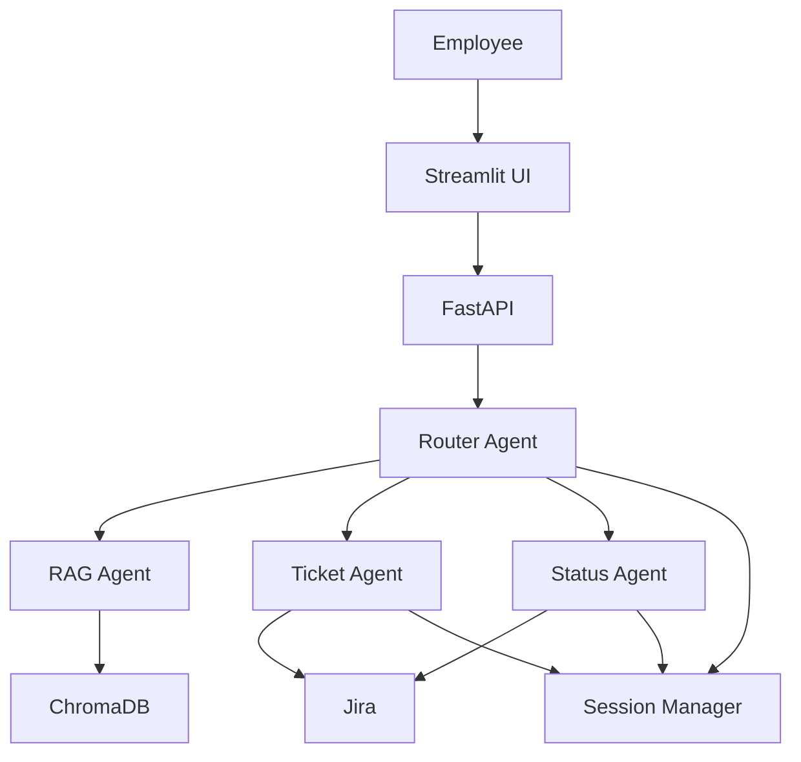

# SmartDesk AI
### Intelligent IT & HR Operations Agent

SmartDesk AI is an AI-powered employee support assistant designed to serve as the first line of support for IT and HR operations.

The system combines:

- Retrieval-Augmented Generation (RAG)
- Agent-based orchestration
- Jira ticket management
- Human-in-the-loop approval workflows
- Multi-turn conversational memory

to provide employees with instant answers from an internal knowledge base while seamlessly escalating unresolved issues to support teams.

---

# Project Objectives

The system supports three core business workflows:

## 1. Knowledge Base Query (RAG)

Employees can ask questions about:

- IT Support
- HR Policies
- Payroll
- Onboarding

Examples:

```text
How do I reset my password?

How many sick leaves do I get?

What is the reimbursement process?

How do I connect to VPN?
```

The assistant retrieves relevant knowledge-base entries and generates grounded responses.

---

## 2. Ticket Creation (Write Operation)

When SmartDesk AI cannot confidently answer a question:

1. Detects insufficient knowledge
2. Escalates automatically
3. Collects user information
4. Creates a ticket in Jira
5. Returns tracking information

Example:

```text
Employee:
My monitor keeps flickering.

Agent:
I do not have enough information to answer this question.

Would you like me to create a support ticket?
```

---

## 3. Ticket Status Lookup (Read Operation)

Employees can request updates on their tickets.

Example:

```text
Employee:
What is the status of my VPN ticket?

Agent:
Ticket IT-123

Status:
In Progress

Assigned To:
Infrastructure Team
```

---

# Features

## Knowledge Base Retrieval

- OpenAI Embeddings
- ChromaDB Vector Database
- Similarity Search
- Confidence Scoring

---

## Escalation Detection

Automatically escalates when:

```python
confidence < 0.75
```

This prevents hallucination and ensures trustworthy responses.

---

## Human-in-the-Loop Approval

Before creating a ticket:

- Ticket summary is generated
- User reviews details
- Explicit approval is required

Example:

```text
Please review the ticket:

Title:
VPN Connection Issue

Priority:
Medium

Category:
IT

Reply YES to create the ticket.
```

---

## Session Memory

The assistant remembers:

- Employee email
- Previous questions
- Pending tickets
- Ticket confirmations
- Conversation history

Within the same session.

---

## Mock Jira Implementation

For evaluation purposes, SmartDesk AI uses a SQLite-backed Mock Jira service.

Features:

- Ticket Creation
- Ticket Persistence
- Ticket Status Lookup
- Multiple Ticket Support
- Status Updates

The mock service follows the same interface as Jira Cloud APIs, allowing a real Jira implementation to be swapped in with minimal code changes.

Supports:

### Ticket Creation

```text
IT Project
HR Project
```

### Ticket Lookup

```text
Open
In Progress
Resolved
Closed
```

---

## Multi-Turn Conversations

Example:

```text
Employee:
How do I connect to VPN?

Agent:
Use GlobalProtect VPN.

Employee:
Still not working.

Agent:
Would you like me to create a ticket?
```

---

# Architecture



---

# Technology Stack

## Backend

- Python 3.11
- FastAPI
- LangChain
- LangGraph

## LLM

- GPT-4o
- OpenAI API

## Retrieval

- OpenAI Embeddings
- ChromaDB

## Ticketing

- Jira Cloud

## Frontend

- Streamlit

## Deployment

- Docker
- Docker Compose

## Testing

- Pytest

---

# Project Structure

```text
smartdesk-ai/

├── app/
│
│   ├── main.py
│   ├── config.py
│
│   ├── agents/
│   │   ├── graph.py
│   │   ├── router.py
│   │   ├── rag_agent.py
│   │   ├── ticket_agent.py
│   │   └── status_agent.py
│
│   ├── rag/
│   │   ├── ingest.py
│   │   ├── retriever.py
│   │   └── vector_store.py
│
│   ├── jira/
│   │   ├── create_ticket.py
│   │   └── status.py
│
│   ├── memory/
│   │   └── session_manager.py
│
│   ├── models/
│   │   ├── schemas.py
│   │   └── session.py
│
│   └── prompts/
│       ├── rag_prompt.py
│       └── router_prompt.py
│
├── knowledge_base/
│   ├── hr.json
│   ├── it.json
│   ├── payroll.json
│   └── onboarding.json
│
├── tests/
│   ├── test_rag.py
│   ├── test_ticket.py
│   └── test_status.py
│
├── streamlit_app.py
├── requirements.txt
├── Dockerfile
├── docker-compose.yml
├── .env.example
└── README.md
```

---

# Environment Variables

Create a `.env` file.

```env
OPENAI_API_KEY=your_openai_api_key

# In our case we have mocked Jira, use this to switch to real JIRA
JIRA_URL=https://your-domain.atlassian.net 

# In our case we have mocked Jira, use this to switch to real JIRA
JIRA_EMAIL=your_email@company.com

# In our case we have mocked Jira, use this to switch to real JIRA
JIRA_API_TOKEN=your_jira_token

CHROMA_DB_PATH=./chroma_db

RETRIEVAL_THRESHOLD=0.75
```

---

# Installation

## Clone Repository

```bash
git clone https://github.com/your-username/smartdesk-ai.git

cd smartdesk-ai
```

---

## Create Virtual Environment

Linux / macOS

```bash
python -m venv venv

source venv/bin/activate
```

Windows

```powershell
python -m venv venv

venv\Scripts\activate
```

---

## Install Dependencies

```bash
pip install -r requirements.txt
```

---

# Build Knowledge Base Index

Generate embeddings and create the vector database.

```bash
python app/rag/ingest.py
```

Expected output:

```text
Indexed 40+ documents
```

---

# Run Backend

```bash
uvicorn app.main:app --reload
```

Backend URL:

```text
http://localhost:8000
```

Swagger Documentation:

```text
http://localhost:8000/docs
```

---

# Run Frontend

```bash
streamlit run streamlit_app.py
```

Open:

```text
http://localhost:8501
```

---

# Docker Deployment

## Build

```bash
docker build -t smartdesk-ai .
```

## Run

```bash
docker run -p 8000:8000 smartdesk-ai
```

---

## Docker Compose

```bash
docker compose up --build
```

---

# API Endpoint

## POST /chat

### Request

```json
{
  "session_id": "abc123",
  "query": "How do I reset my password?"
}
```

### Response

```json
{
  "response": "Visit the Self-Service Password Portal and select Forgot Password."
}
```

---

# Workflow

## Knowledge Query Flow

```text
User Question
      │
      ▼

Intent Detection

      │
      ▼

RAG Retrieval

      │
      ▼

Generate Grounded Answer

      │
      ▼

Return Response
```

---

## Escalation Flow

```text
User Question
      │
      ▼

RAG Retrieval

      │
      ▼

Confidence Check

      │
 ┌────┴────┐
 │         │

High      Low

 │         │

 ▼         ▼

Answer   Escalate
```

---

## Ticket Creation Flow

```text
Escalation

      │
      ▼

Collect Email

      │
      ▼

Generate Ticket

      │
      ▼

Show Confirmation

      │
      ▼

User Approves

      │
      ▼

Create Jira Ticket

      │
      ▼

Return Ticket ID
```

---

## Ticket Status Flow

```text
Status Request

      │
      ▼

Retrieve Email

      │
      ▼

Search Jira

      │
      ▼

Return Status
```

---

# Sample Conversation

## Knowledge-Base Answer

```text
Employee:
How do I reset my password?

Agent:
Use the Self-Service Password Portal and click Forgot Password.
```

---

## Escalation

```text
Employee:
My monitor is flickering.

Agent:
I do not have enough information to answer this question.

Would you like me to create a support ticket?
```

---

## Human Approval

```text
Employee:
YES

Agent:
Ticket created successfully.

Ticket ID:
IT-1234
```

---

## Ticket Status

```text
Employee:
What is the status of my ticket?

Agent:
Ticket: IT-1234

Status:
In Progress

Assigned To:
Infrastructure Team
```

---

# Running Tests

```bash
pytest tests/
```

---

# Knowledge Base Coverage

Current domains:

## IT Support

- Password Reset
- VPN Setup
- MFA
- Software Installation
- Email Configuration
- Shared Drives
- WiFi Access

## HR Policies

- Leave Policies
- WFH Guidelines
- Reimbursements
- Performance Reviews
- Code of Conduct

## Payroll

- Payday Schedule
- Tax Declaration
- Payslips
- Bank Details
- Payroll Queries

## Onboarding

- Day One Checklist
- Equipment Allocation
- Benefits Enrollment
- Buddy Program
- Probation

---

# Security Considerations

- Environment-based secrets
- No hardcoded credentials
- Input validation
- Human approval before ticket creation
- Jira access controlled via API token

---

# Capstone Requirements Mapping

| Requirement | Status |
|------------|---------|
| RAG Pipeline | ✅ |
| Knowledge Base | ✅ |
| ChromaDB | ✅ |
| Confidence Handling | ✅ |
| Escalation Logic | ✅ |
| Ticket Creation | ✅ |
| Human-in-the-Loop | ✅ |
| Ticket Status Retrieval | ✅ |
| Multi-turn Conversations | ✅ |
| Session Memory | ✅ |
| FastAPI Backend | ✅ |
| Streamlit Frontend | ✅ |
| Docker Deployment | ✅ |
| Unit Tests | ✅ |
| Documentation | ✅ |

---

# Future Improvements

- Hybrid Search (BM25 + ChromaDB)
- Redis Session Persistence
- RAGAS Evaluation
- LangSmith Tracing
- Microsoft Teams Integration
- Slack Integration
- OAuth Authentication
- CI/CD Pipeline
- Kubernetes Deployment

---

# Author

**Reema Agarwal**

SmartDesk AI Capstone Project

Applied Agentic AI Program

